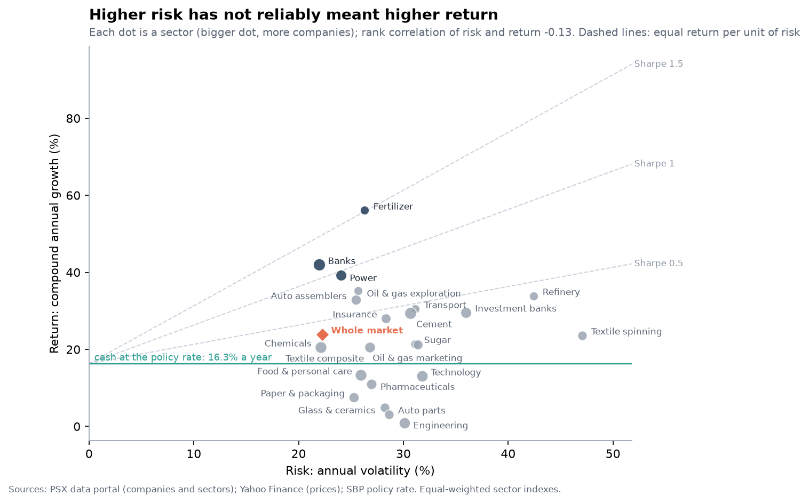
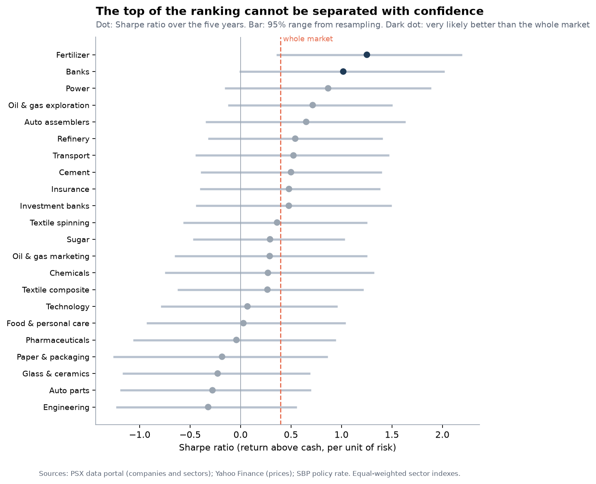
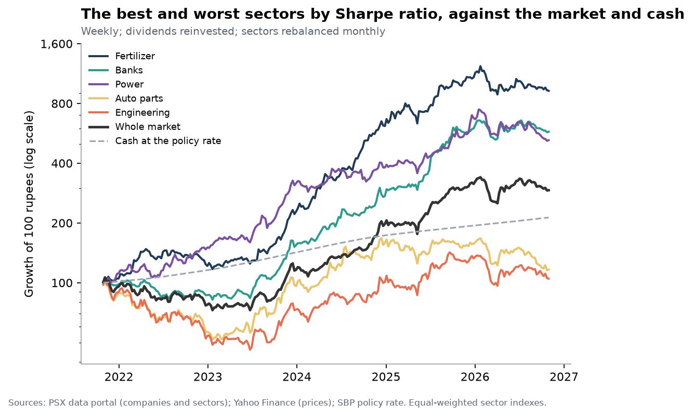
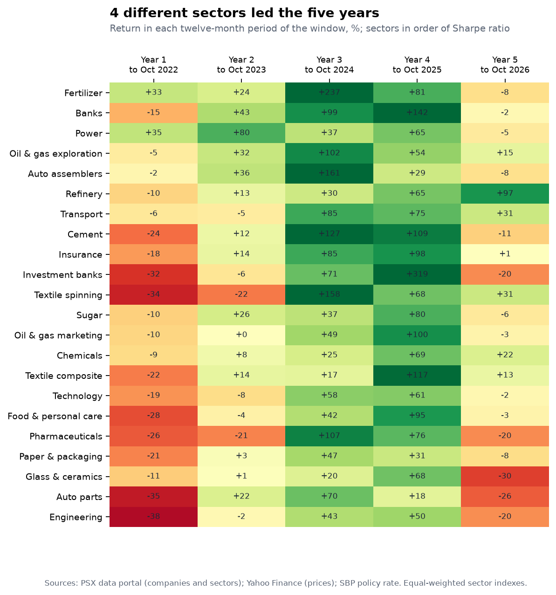
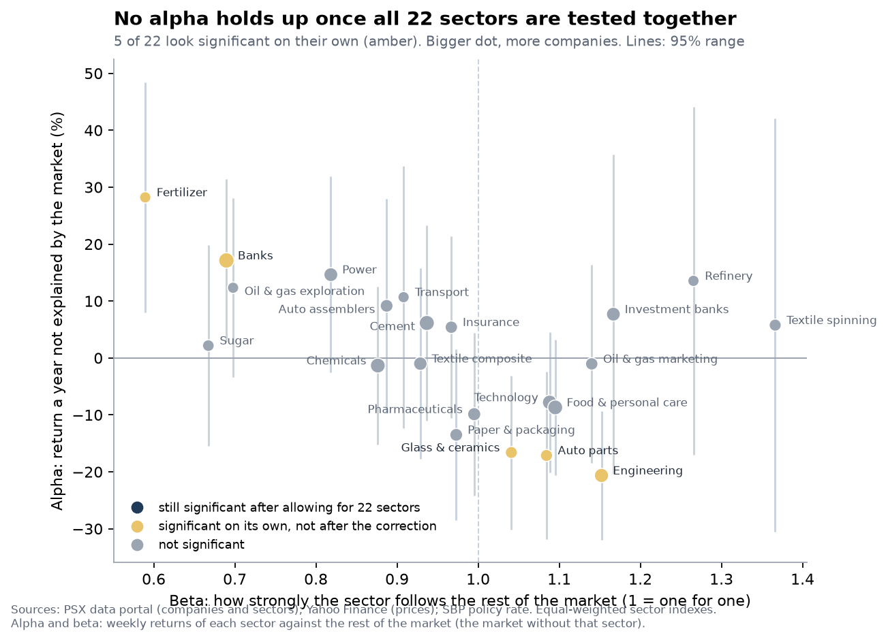
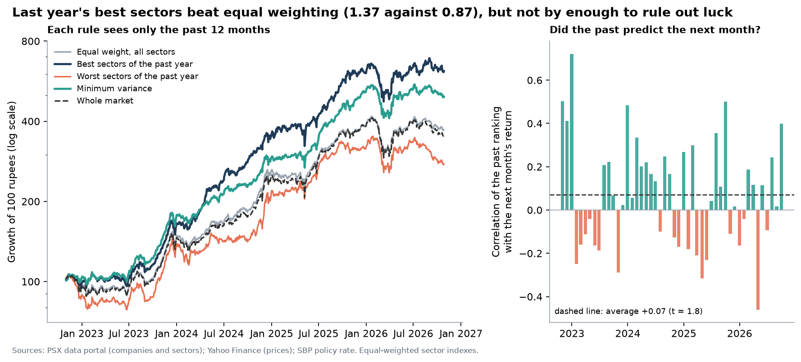
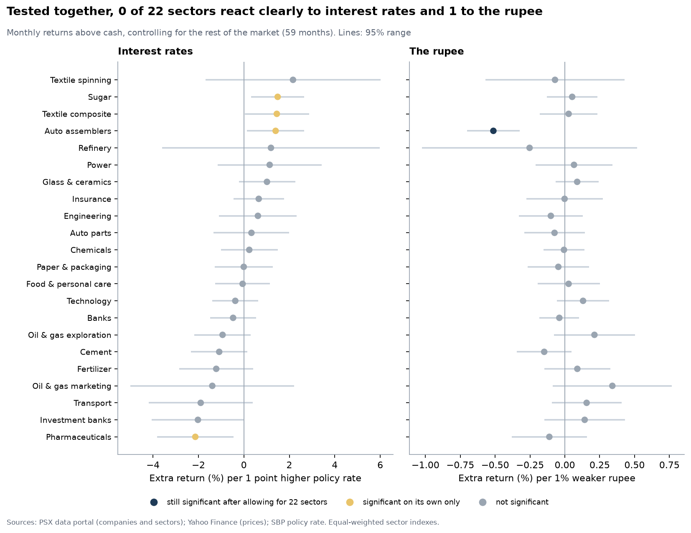
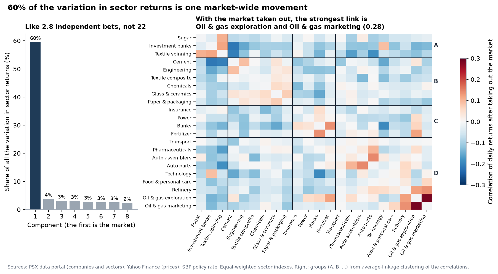

# PSX sector risk and return: which sectors paid best for the risk

[](https://github.com/Maira-W/psx-sector-risk-return/actions/workflows/ci.yml)

[](LICENSE)

Over the five years from 27 October 2021 to 27 October 2026, **which sectors of the Pakistan Stock Exchange gave investors the best return for the risk they carried?** This project builds an index for each sector from the 209 companies that trade regularly, measures return, volatility, the worst fall and the Sharpe ratio (return above cash per unit of risk), and says how sure the ranking is. A second layer asks whether the leaders earned their record by skill or by luck (beta, alpha and a correction for looking at 22 sectors at once), what moves the sectors (the market, interest rates, the rupee, neighbouring industries) and whether the ranking could have been used (a walk-forward test that never looks ahead, and a portfolio builder). It is analysis of the past, not investment advice.

| | |
|---|---|
| **Interactive dashboard** | [maira-w.github.io/psx-sector-risk-return](https://maira-w.github.io/psx-sector-risk-return/) (eight tabs: the answer, sector scorecard, ups and downs, how sure are we, risk and alpha, what moves them, portfolios with a builder, method) |
| **Notebook** | [`notebooks/sector_risk_return.ipynb`](notebooks/sector_risk_return.ipynb), a step-by-step walk-through with its outputs |
| **Memo** | [`docs/recommendation_memo.md`](docs/recommendation_memo.md) |
| **Method and data** | [methodology](docs/methodology.md) · [data sources](docs/data_sources.md) |
| **Results as CSV** | [`data/processed`](data/processed) (plain files for Excel or Power BI) |

## What the data show

1. **The whole market returned 23.9% a year,** with volatility of 22% and a worst fall of -32% (from Nov 2021 to Jan 2023). Cash earning the State Bank's policy rate returned 16.3% a year over the same years (the policy rate began at 7.25%, peaked at 22.0% and ended at 12.0%). The market's Sharpe ratio was 0.40.
2. **By return per unit of risk the leaders were Fertilizer (1.25), Commercial banks (1.02) and Power generation and distribution (0.87).** Fertilizer returned 56.1% a year with volatility of 26% and a worst fall of -32%. The weakest were Glass and ceramics (-0.23), Automobile parts (-0.28) and Engineering (-0.32).
3. **The top of the ranking is not secure. Fertilizer finishes first in only 54% of the resampled histories, and 3 sectors have at least a 10% chance of finishing first. Read the top group as a shortlist, not a winner.** 2 of the 22 ranked sectors are very likely better than the whole market (Fertilizer and Commercial banks) and 5 very likely worse.
4. **Return and return per unit of risk agree at the top.** Fertilizer had the highest return (56.1% a year) with volatility of 26% and a worst fall of 32%; it ranks 1 of 22 by Sharpe ratio (1 is best).
5. **Falls were deep.** 22 of 22 sectors fell more than 20% from a peak at some point. The deepest was Textile spinning (-62%), the shallowest Commercial banks (-24%). 7 sectors were still below their old peak at the end of the window.
6. **Dividends were a meaningful part of the return.** In the typical sector dividends supplied about 22% of the annual return (3.4 percentage points); the most was 20.0 points in Power generation and distribution.
7. **Leadership rotated almost every year.** 4 different sectors led the five twelve-month periods (Fertilizer, Investment banks and securities, Power generation and distribution and Refinery), and the rank correlation between the first and second half of the window is 0.16 (1 would mean the same order). The ranking moves a fair amount with the dates used.
8. **The ranking is fairly stable when the method is changed.** The ranking was repeated 8 ways that change the method (KSE-100 companies only, looser and tighter trading rules, rebalancing every day, weekly returns, dropping each sector's best company, leaving out companies with price corrections, the typical company instead of the average). The rank correlation with the main result is 0.97 at the median and 0.88 at the lowest, and the top sector stays in the top three in 7 of the 7 in which it is included.
9. **Beta.** Against the rest of the market (the market without that sector) the median beta was 0.97, from 0.59 for Fertilizer to 1.37 for Textile spinning; the rest of the market explains a median 53% of a sector's weekly ups and downs. Sectors with a lower beta tended to have the higher Sharpe ratio (rank correlation -0.52), and all of the top three are among the five lowest-beta sectors. That describes these five years, in which the whole market's Sharpe ratio was 0.40.
10. **No sector's alpha holds up once all 22 are tested together.** Tested one at a time, 5 of the 22 sectors look real (2 positive, 3 negative). The largest alpha is Fertilizer's, +28% a year (p = 0.006 on its own, 0.087 once all 22 sectors are allowed for). The deflated Sharpe ratio, which asks whether the best of 22 could reach that level by luck, is 0.84 for Fertilizer; 0.95 would be convincing. On the looser false-discovery-rate rule, which accepts that a small share of findings may be false, Engineering (-21% a year) clears the bar.
11. **The past ranking beat equal weighting out of sample, but not by more than luck could give.** Each month a rule chose weights using only the previous 12 months. Holding the 3 best sectors gave a Sharpe ratio of 1.37 against 0.87 for equal weights over 48 months from Nov 2022 (p = 0.070; 0.350 after allowing for five comparisons), and it was ahead in 5 of 6 choices of look-back and number of sectors. On average the past ranking pointed the right way, but only weakly. Weights chosen to make the portfolio as steady as possible gave a volatility of 19% against 23% and a Sharpe ratio of 1.35 against 0.87. The gain in Sharpe ratio is significant on its own (p = 0.018) but not after allowing for the five comparisons made (p = 0.090).
12. **What moves the sectors.** 60% of the variation in sector returns is one market-wide movement, so the 22 sectors behave like 2.8 independent bets. With the market taken out, the average correlation between two sectors falls from 0.57 to -0.04; the strongest remaining link is Oil and gas exploration with Oil and gas marketing (0.28). Tested together, 0 of the 22 sectors react clearly to interest rates and 1 to the rupee (Automobile assemblers).

<table>
<tr>
<td width="50%"><a href="docs/figures/01_risk_vs_return.png"></a><br><sub>Risk and return by sector</sub></td>
<td width="50%"><a href="docs/figures/02_sharpe_ranking.png"></a><br><sub>Return per unit of risk, with 95% ranges</sub></td>
</tr>
<tr>
<td><a href="docs/figures/03_growth_of_100.png"></a><br><sub>Growth of 100 rupees: best and worst sectors, the market and cash</sub></td>
<td><a href="docs/figures/05_year_by_year.png"></a><br><sub>Year-by-year returns</sub></td>
</tr>
</table>

The second layer:

<table>
<tr>
<td width="50%"><a href="docs/figures/10_alpha_and_beta.png"></a><br><sub>Alpha and beta, with the sectors whose alpha is significant on its own and after the correction</sub></td>
<td width="50%"><a href="docs/figures/11_out_of_sample.png"></a><br><sub>The walk-forward test: each rule sees only the past</sub></td>
</tr>
<tr>
<td><a href="docs/figures/12_rates_and_rupee.png"></a><br><sub>Interest rates and the rupee</sub></td>
<td><a href="docs/figures/13_sector_structure.png"></a><br><sub>One market, a few extra bets, and the groups that remain</sub></td>
</tr>
</table>

All thirteen figures are in [`docs/figures`](docs/figures).

## What to take from it

- **Use it to build a shortlist, not to pick a winner.** Fertilizer, Commercial banks, Power generation and distribution, Oil and gas exploration and Automobile assemblers are the five best by Sharpe ratio. The leader's 95% range is 0.36 to 2.20, and the 95% ranges of the next four sectors all overlap it, so the data cannot separate them from it.
- **Look at the worst fall as well as the return.** Fertilizer had the highest return and still fell 32% from a peak at one point.
- **Check what the return was made of.** Dividends supplied 3.4 points of the typical sector's annual return, and a sector index treats a small company like a large one.
- **Do not read a good record as skill.** No sector's alpha holds up once all 22 are tested together. With 22 sectors, some will always look special by chance, which is why the p-values are corrected.
- **Think in bets, not sector names.** The 22 sectors behave like 2.8 independent bets, so owning more of them diversifies less than the count suggests.
- **Treat five years as one history.** The window spans the policy rate rising from 7.25% to 22.0% and then coming down to 12.0%; a different five years would rank the sectors differently.

The [memo](docs/recommendation_memo.md) sets out the reasoning, what is solid, what is not, and what would change the answer.

## How it works

```
data/raw  ──build──▶  data/interim  ──analyze──▶  data/processed  ──report──▶  docs/figures · dashboard/ · docs/
 (downloaded;          (clean returns)             (results)                    (everything you open)
  fingerprinted)
```

| Stage | What it does |
|---|---|
| `ingest` | Downloads the PSX company and sector list and daily prices from Yahoo Finance for 538 companies, and records a SHA-256 fingerprint, source and date for each file in [`data/raw/MANIFEST.json`](data/raw/MANIFEST.json). `verify` checks any raw file that is present. |
| `build` | Drops holidays, picks the five-year window, checks the prices (no duplicates, no zero prices), corrects wrong prices and unadjusted corporate actions by fixed rules (every correction is listed), and keeps the companies that trade regularly. |
| `analyze` | Builds the sector indexes, measures return and risk, resamples the days to say how sure the ranking is, and repeats everything under 8 other choices. Then the second layer: market model and alpha with a correction for testing 22 sectors, the effect of interest rates and the rupee, the principal components and groups, and the walk-forward test. |
| `report` | Draws the figures, builds the dashboard and writes these documents. |
| `notebook` | Re-runs the notebook from the committed results (needs the extras in `requirements-notebook.txt`). |

The documents (including this file) are written from [`psxsec/templates`](psxsec/templates) and the results, so a number in the text cannot disagree with the data. Edit the template, not the output.

## Data

| Source | Used for | Retrieved |
|---|---|---|
| Pakistan Stock Exchange data portal (screener page) | Which companies are in the KSE All Share Index and the KSE-100, and each company's sector | 2026-10-28 |
| Yahoo Finance, through `yfinance` 1.7.0 | Daily prices, volume and dividends | 2026-10-28 |
| State Bank of Pakistan policy rate (typed in with a source for each change) | The safe rate in the Sharpe ratio | [`data/reference/policy_rate.csv`](data/reference/policy_rate.csv) |

The raw prices are **not stored in this repository**; they belong to their sources, and `python -m psxsec ingest` downloads them again. What is committed is the list of companies and sectors, the policy-rate table, and every result computed from the prices. Details and the data problems found are in [`docs/data_sources.md`](docs/data_sources.md).

## Quality checks

- **Prices are checked before use.** No duplicate rows, no price of zero or less, no negative volume; the window must end on a market day. Yahoo's prices also contain wrong prices (a share at a fifth of its level for a few days) and unadjusted bonus issues and splits; 110 such events in 70 of the 209 qualifying companies are corrected by fixed rules and every one is listed in [`data/processed/price_corrections.csv`](data/processed/price_corrections.csv).
- **Total returns are computed from price and dividends, then cross-checked.** Each day's return is (price today + dividend paid today) ÷ price yesterday − 1. Against the returns implied by Yahoo's own dividend-adjusted prices they agree to within half a point on 99.98% of stock-days. Over five years the median company differs by 0.11 points and 14 of 209 by more than 5; the two differ most for companies that paid very large dividends (the largest gap is FHAM, 54 points). Yahoo's adjusted series is invalid for PHDL (it goes negative), which is why it is not used for returns.
- **Every headline measure can be recomputed** from the committed daily sector returns, and a test does that for every sector.
- **The sample rules were set before looking at returns** (the trading rule of 90% of days, the history rule, the minimum sector size), and the trading rule is also tested at 80% and 95%. The price-cleaning rules and the choice of monthly rebalancing were set afterwards, from inspecting the data (not from looking at which sector ranked where), and both are tested too.
- **The statistics are tested where the answer is known.** The market model recovers the betas and the alpha of made-up markets; on made-up markets of pure noise the corrected test rarely flags a sector, where the usual 5% p-value would flag at least one of 22 sectors by chance in about 68% of them; the walk-forward test cannot see the future; and the clustering finds groups that were planted.
- **Tests** cover the metrics on cases with known answers, the build and analysis on made-up markets, the committed results, the documents, the dashboard and the notebook. They run on every push.

## Limitations

- **Five years is short:** one cycle of the policy rate rising and falling, and the sector order depends on when each sector was strong.
- **Only companies listed today** are included. Companies delisted during the window are missing, which flatters returns; this is probably smaller than it would be with the KSE-100, whose members favour companies that have grown, but it is not zero.
- **Equal weights:** a small company counts as much as a large one.
- **The out-of-sample test looks forward only in time:** the rules see only the past when they choose, but the companies are today's survivors and there is only one history, so no result is a forecast. The corrections for testing many sectors and rules limit false findings; they do not make five years longer.
- **Yahoo Finance is not an official source.** Dividends it does not record are missing, so dividend contributions may be understated.
- **Rupee returns:** rupees per dollar went from 174.5 to 276.8, so in dollars the whole market returned 13.0% a year against 23.9% in rupees.
- **Sectors with fewer than 4 qualifying companies are not ranked** (Leather and tanneries, Modarabas, Apparel, Textile weaving, Tobacco and Cable and electrical goods), and "Miscellaneous" is a catch-all, not a sector.
- **Past performance does not predict future returns.**

## Reproduce it

```bash
python -m venv .venv && .venv\Scripts\activate        # macOS or Linux: source .venv/bin/activate
pip install -r requirements-dev.txt
python -m psxsec ingest         # download the company list and prices (about half an hour; needs the internet)
python -m psxsec all            # build, analyze and report (a few minutes)
pytest                          # run the tests
```

The committed results are deterministic given the downloaded prices (seed 42). A fresh download later will differ a little: Yahoo revises dividends and splits, and the window is fixed to end on 27 October 2026, but companies can be delisted or restated. `python -m psxsec notebook` re-runs the notebook.

## Layout

```
psxsec/            the package: ingest, build, metrics, stats, portfolios, advanced, analysis, charts, dashboard, docs, notebook
  templates/       dashboard page and document templates
data/reference/    the company and sector list and the policy-rate table (with sources)
data/raw/          MANIFEST.json (the raw files themselves are downloaded, not stored)
data/processed/    results as CSV and JSON
docs/              memo, methodology, data sources, figures
dashboard/         the interactive dashboard (one HTML file)
notebooks/         the walk-through notebook
tests/             pytest suite
.github/workflows/ continuous integration
```

## Licence

The code and documents are released under the [MIT licence](LICENSE). The data belong to their sources (the Pakistan Stock Exchange, Yahoo Finance and the State Bank of Pakistan); see [`docs/data_sources.md`](docs/data_sources.md). This is not investment advice.
