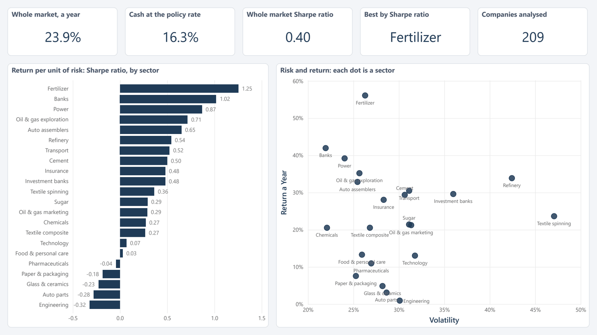
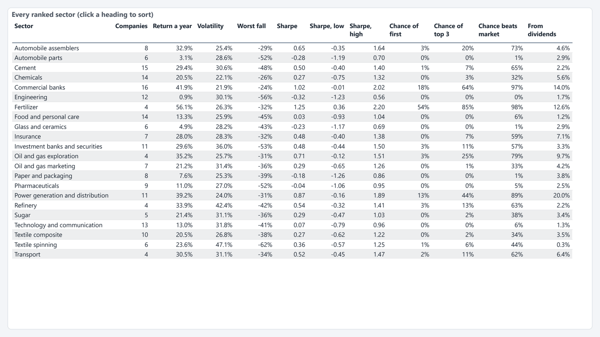
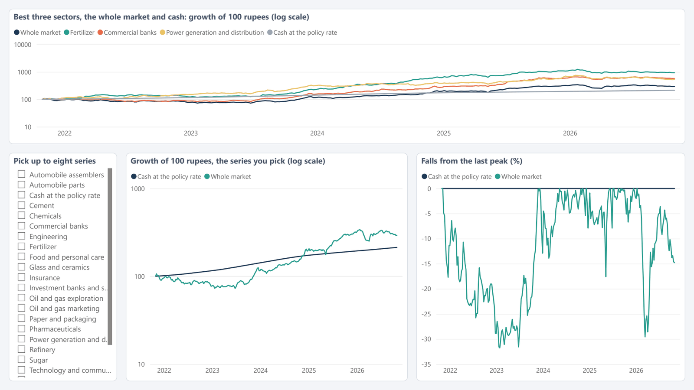
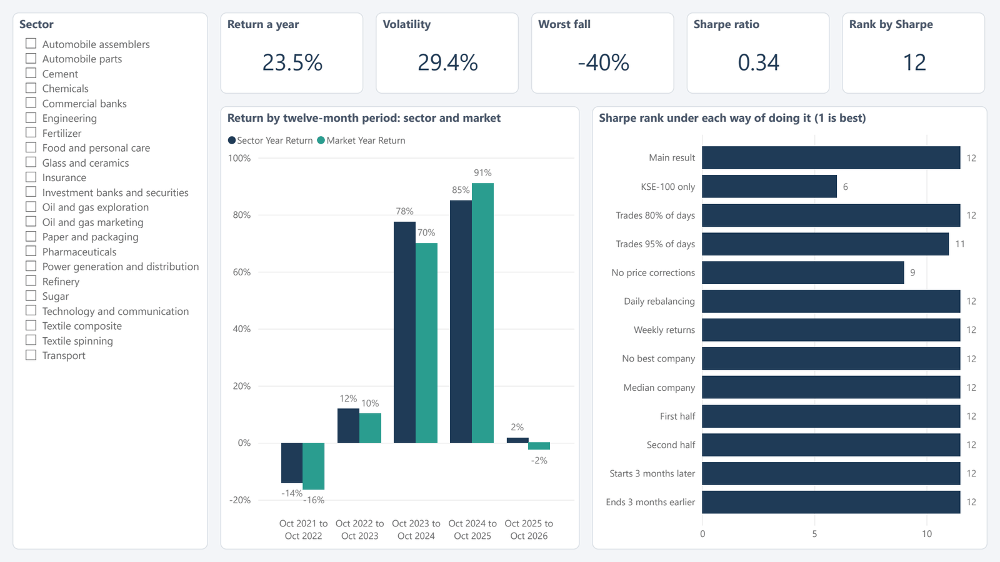
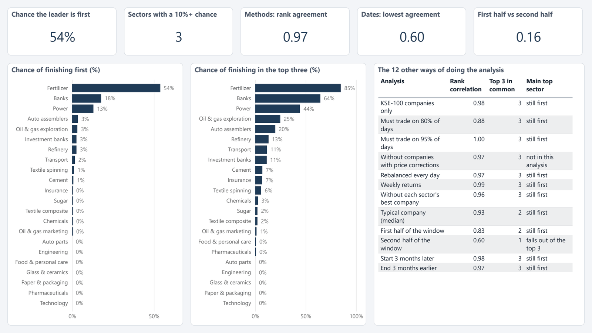
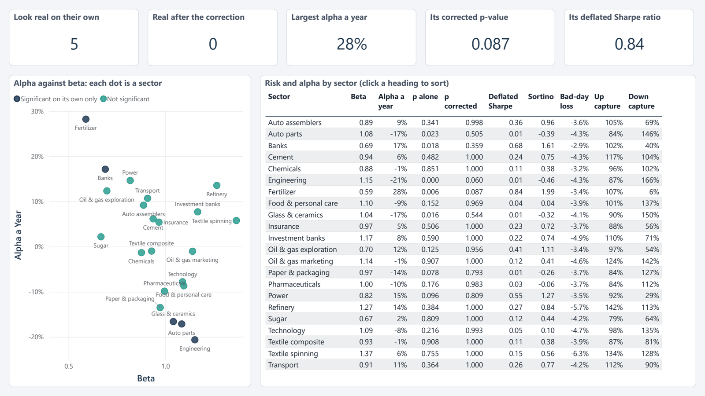
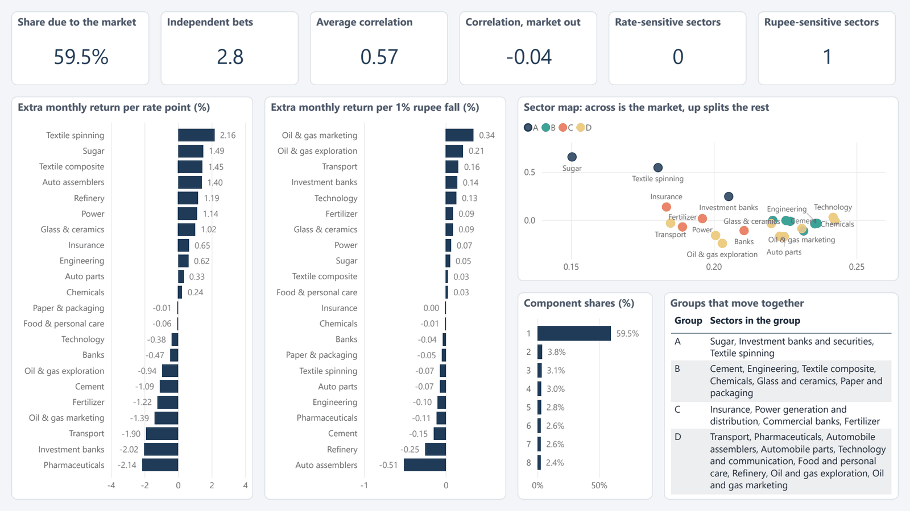
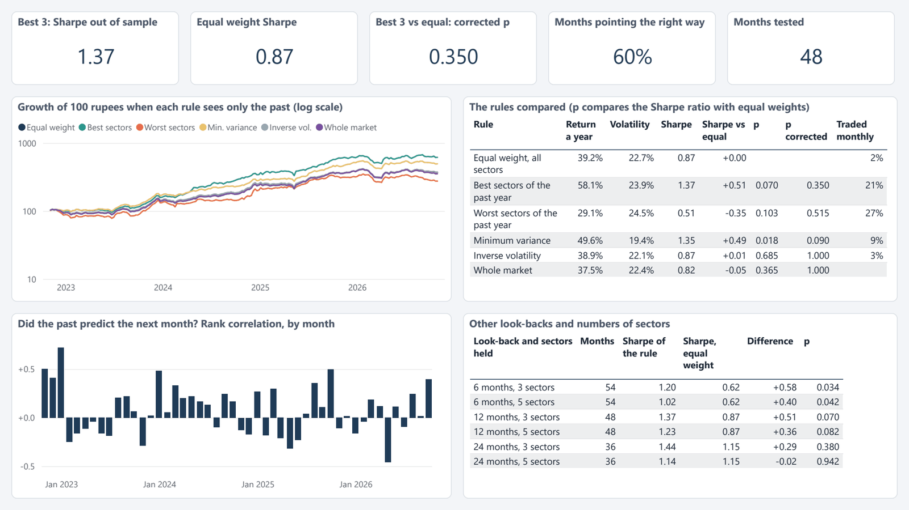
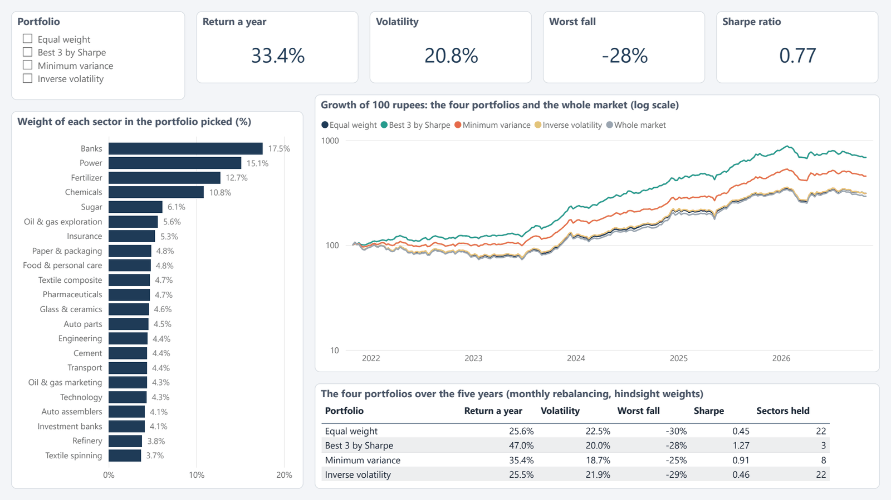
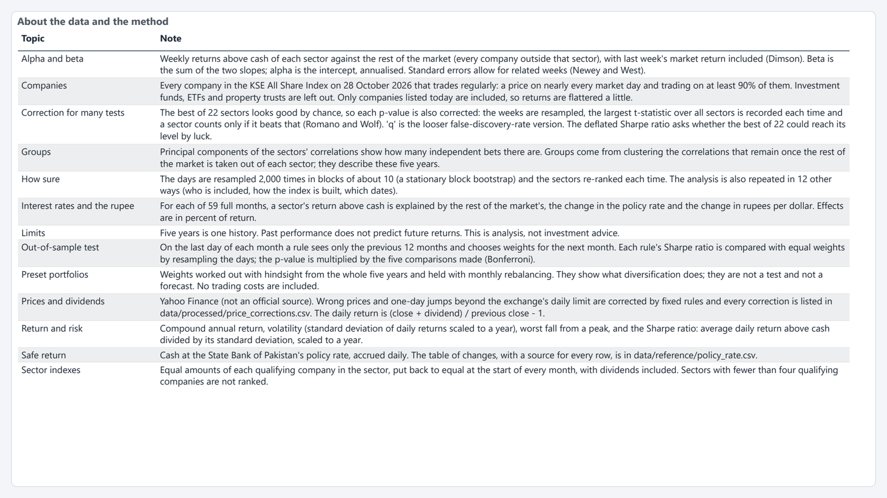

# Power BI report

A 10-page report built on a model of 18 tables and 85 DAX measures. It uses the same numbers as the web dashboard and the documents, because all three are generated from the same results in `data/processed`.

## Opening it

| File | Use it for |
|---|---|
| [`PSX_Sector_Risk_Return.pbix`](../powerbi/PSX_Sector_Risk_Return.pbix) | **Just looking.** The data is inside; double-click and it opens. Needs Power BI Desktop (free from Microsoft). |
| [`PSX_Sector_Risk_Return.pbip`](../powerbi/PSX_Sector_Risk_Return.pbip) | **Working on it, or reading it in Git.** A Power BI project: the model is plain text (TMDL) and each page and visual is a small JSON file. A project stores no data, so Power BI Desktop shows a **Refresh now** banner the first time; click it once and wait. |
| [`measures.dax`](../powerbi/measures.dax) | Every measure as text, grouped by folder, with a description. |

`python -m psxsec powerbi` (also run by `python -m psxsec report`) regenerates the project and `measures.dax`. The `.pbix` is a snapshot saved from the opened project (File, Save as) and is not rewritten by that command.

## Pages

| # | Page | What it shows | Visuals | Made of |
| ---: | --- | --- | ---: | --- |
| 1 | **Overview** | The headline: which sectors paid best for the risk, and how risk and return line up across the 22 ranked sectors. | 7 | 5 cards, 1 bar chart, 1 scatter chart |
| 2 | **Sector scorecard** | Every ranked sector in one sortable table: return, volatility, worst fall, Sharpe ratio with its 95% range, and the chances of finishing first. | 1 | 1 table |
| 3 | **Ups and downs** | Growth of 100 rupees and falls from the last peak: the best three sectors, the market and cash, then any series you pick. | 4 | 3 line charts, 1 slicer |
| 4 | **Sector detail** | One sector at a time: its numbers, its return in each twelve-month period against the market, and its rank under every way of doing the analysis. | 8 | 5 cards, 1 slicer, 1 column chart, 1 bar chart |
| 5 | **How sure are we?** | How far to trust the order: the chance each sector finishes first or in the top three in 2,000 resampled histories, and the 12 other ways of doing the analysis. | 8 | 5 cards, 2 bar charts, 1 table |
| 6 | **Risk and alpha** | Skill or luck: alpha against beta, which sectors look real on their own and after the correction for testing 22, and more measures of risk. | 7 | 5 cards, 1 scatter chart, 1 table |
| 7 | **What moves them** | What moves the sectors: how much is one market-wide movement, the effect of interest rates and the rupee, and the groups that remain. | 11 | 6 cards, 3 bar charts, 1 scatter chart, 1 table |
| 8 | **Out-of-sample test** | Could the ranking have been used? Rules that choose weights using only the past, against equal weights, month by month. | 9 | 5 cards, 2 tables, 1 line chart, 1 column chart |
| 9 | **Portfolios** | Four portfolios worked out with hindsight, held with monthly rebalancing: what diversification does. | 8 | 4 cards, 1 slicer, 1 bar chart, 1 line chart, 1 table |
| 10 | **About the data** | Sources, definitions and caveats. | 1 | 1 table |

Slicers cross-filter the other visuals on a page. The sector slicer on **Sector detail** filters the year-by-year and rank charts through the relationships below, and the portfolio slicer on **Portfolios** filters the weights.

## Preview

Every page, exported from Power BI Desktop (File, Export, Export to PDF) and saved as an image. Click an image for the full size.

<table>
<tr>
<td width="50%"><a href="powerbi_pages/01_overview.png"></a><br><sub>Page 1: Overview</sub></td>
<td width="50%"><a href="powerbi_pages/02_scorecard.png"></a><br><sub>Page 2: Sector scorecard</sub></td>
</tr>
<tr>
<td width="50%"><a href="powerbi_pages/03_ups.png"></a><br><sub>Page 3: Ups and downs</sub></td>
<td width="50%"><a href="powerbi_pages/04_detail.png"></a><br><sub>Page 4: Sector detail</sub></td>
</tr>
<tr>
<td width="50%"><a href="powerbi_pages/05_sure.png"></a><br><sub>Page 5: How sure are we?</sub></td>
<td width="50%"><a href="powerbi_pages/06_alpha.png"></a><br><sub>Page 6: Risk and alpha</sub></td>
</tr>
<tr>
<td width="50%"><a href="powerbi_pages/07_moves.png"></a><br><sub>Page 7: What moves them</sub></td>
<td width="50%"><a href="powerbi_pages/08_oos.png"></a><br><sub>Page 8: Out-of-sample test</sub></td>
</tr>
<tr>
<td width="50%"><a href="powerbi_pages/09_presets.png"></a><br><sub>Page 9: Portfolios</sub></td>
<td width="50%"><a href="powerbi_pages/10_about.png"></a><br><sub>Page 10: About the data</sub></td>
</tr>
</table>

## Data model

| Table | Rows | Columns | Role |
| --- | ---: | ---: | --- |
| `sectors` | 22 | 56 | One row per ranked sector: return, risk, the chance of each rank, alpha and beta, rate and rupee effects, group. The main table. |
| `market` | 1 | 46 | One row of single numbers about the whole market, cash and the tests (read by cards). |
| `market_years` | 5 | 3 | The whole market's return in each of the five twelve-month periods. |
| `levels_top` | 1310 | 4 | Weekly growth of 100 rupees for the best three sectors, the whole market and cash. |
| `levels` | 6288 | 4 | Weekly growth of 100 rupees and fall from the last peak for every sector, the market and cash. |
| `year_returns` | 110 | 4 | Each sector's return in each of the five twelve-month periods. Filtered by the sector slicer. |
| `rank_choices` | 286 | 7 | Each sector's Sharpe ratio and position under the main analysis and the 12 other ways of doing it. |
| `robustness_summary` | 12 | 7 | The 12 other ways of doing the analysis, with how closely each agrees with the main ranking. |
| `strategies` | 6 | 13 | The five rules and the whole market in the out-of-sample test, with their Sharpe ratios and p-values. |
| `strategy_levels` | 1254 | 5 | Weekly growth of 100 rupees for each rule in the out-of-sample test. |
| `info_coeff` | 48 | 3 | Each month, the rank correlation between past Sharpe ratios and the next month's returns. |
| `sensitivity` | 6 | 10 | The best-sectors rule again with other look-backs and numbers of sectors. |
| `presets` | 55 | 5 | The weights of the four preset portfolios (holdings below 0.05% are left out). |
| `preset_stats` | 4 | 7 | Return, volatility, worst fall and Sharpe ratio of the four preset portfolios. Filters the weights. |
| `preset_levels` | 1310 | 4 | Weekly growth of 100 rupees for the four portfolios and the whole market. |
| `components` | 8 | 3 | Share of the variation in sector returns carried by each principal component. |
| `groups` | 4 | 3 | The groups of sectors that move together once the market is taken out. |
| `notes` | 13 | 2 | The text on the About page. |

```
sectors ──< year_returns          preset_stats ──< presets
   └──────< rank_choices
(one to many)                     (one to many)
```

Only three tables are related. The rest are read by measures that filter them directly (for example `strategies[strategy_key] = "winners"`) or are plotted by themselves, like the weekly growth tables. Each table is stored in the model itself as compressed text, which is how Power BI keeps "Enter data" tables, so the project needs no other file. Text columns that should not sort alphabetically carry a `sortByColumn` (the twelve-month periods, the rules, the portfolios, the legend of the alpha chart).

## Measures

| Folder | Measures | Examples |
| --- | ---: | --- |
| The whole market | 10 | `Market Return a Year`, `Cash Return a Year`, `Market Excess Return a Year`, `Market Volatility`, ... |
| Return and risk | 18 | `Sector Count`, `Return a Year`, `Volatility`, `Worst Fall`, ... |
| How sure | 10 | `Chance of First`, `Chance of Top 3`, `Chance Better Than Market`, `Sectors With a 10% Chance of First`, ... |
| Skill or luck | 20 | `Beta`, `Alpha a Year`, `Alpha t`, `Alpha p Alone`, ... |
| What moves the sectors | 11 | `Rate Effect`, `Rupee Effect`, `Market Share of Variation`, `Effective Bets`, ... |
| Out of sample | 10 | `Strategy Level`, `Winners Sharpe`, `Equal Weight Sharpe`, `Winners p Alone`, ... |
| Preset portfolios | 6 | `Preset Weight`, `Preset Level`, `Preset Return a Year`, `Preset Volatility`, ... |

A few patterns worth knowing:

- **Measures live in a table called `_Measures`.** Power BI rejects a table named `Measures`.
- **A number about the whole market is read from a one-row table.** `Market Return a Year` is `MAX ( market[market_cagr] )`, and the text measures (`Top Sector by Sharpe`) use `SELECTEDVALUE`, because `MAX` does not work on text.
- **A per-sector measure is an average over one row.** `Sharpe Ratio` is `AVERAGE ( sectors[sharpe] )`: a bar chart with one bar per sector shows each sector's value, and a card shows that sector's value when the sector slicer has one selected.
- **Counting is done in the measure, not stored.** `Alpha Significant After Correction` counts the sectors whose corrected p-value is below 0.05, so it answers to any slicer. It is wrapped in `COALESCE` because a count of nothing is blank in DAX and a card would show "(Blank)" instead of 0:

  ```dax
  Alpha Significant After Correction =
  COALESCE ( CALCULATE ( COUNTROWS ( sectors ), sectors[alpha_p_adjusted] < 0.05 ), 0 )
  ```
- **A measure that shows the right amount.** Plotting all 22 sectors and the market on one chart is unreadable, so on **Ups and downs** the list picks the series and the measure draws them when between one and eight are picked. Until the reader picks, it draws only the whole market and cash:

  ```dax
  Selected Level =
  VAR picked = COUNTROWS ( ALLSELECTED ( 'levels'[series] ) )
  VAR shown = SELECTEDVALUE ( 'levels'[series] )
  RETURN
      IF ( picked <= 8 || shown IN { "Whole market", "Cash at the policy rate" }, AVERAGE ( 'levels'[level] ), BLANK () )
  ```
  The table is written `'levels'` because Power BI reads the bare word `levels` as a keyword ("the syntax for 'levels' is incorrect"). Evaluating every measure in Desktop is what found it.
- **A second series without a relationship.** The sector against the whole market, period by period, uses `TREATAS` to line the market's table up with the periods in view:

  ```dax
  Market Year Return =
  CALCULATE (
      AVERAGE ( market_years[period_return] ),
      TREATAS ( VALUES ( year_returns[period_index] ), market_years[period_index] )
  )
  ```

## How it was built and checked

- The model, report and theme are written by [`psxsec/powerbi`](../psxsec/powerbi) from `data/processed`; none of it is edited by hand. The project is written in the format Power BI Desktop itself saves.
- Power BI Desktop 2.159.1231.0 opened the saved `.pbix`. All 85 measures were evaluated through its local model and none returned an error, and every value equals the one worked out in Python from the same tables, for example 23.9% a year for the whole market, Fertilizer as the best sector by Sharpe ratio, 5 sectors with an alpha that looks real on its own and 0 after the correction, and a Sharpe ratio of 1.37 against 0.87 for the best-sectors rule and equal weights. The values Desktop returned are saved in [`powerbi/measure_values.json`](../powerbi/measure_values.json) and a test compares each one with Python.
- Every page was opened in Power BI Desktop and inspected. That found problems no test could: two measures Power BI rejected (the table called `levels` has to be quoted in DAX), a count that showed "(Blank)" instead of 0, a log-scale setting that Power BI ignores unless it is written the way Power BI writes it, a pick-a-series chart that was empty until something was picked, and titles, labels and table columns that were cut off. Each was fixed and the pages were looked at again. The images in [`powerbi_pages`](powerbi_pages) are the pages after the fixes, exported from Desktop (File, Export, Export to PDF).

## Limits

- Built and tested with a current Power BI Desktop (the project format needs a recent version). Older versions may not open the `.pbip`; the `.pbix` is saved by the version used here.
- The `.pbix` and the page images in [`powerbi_pages`](powerbi_pages) come from Power BI Desktop and are not rewritten by `python -m psxsec report`. If the data or the generator change, open the project, refresh, check the pages and save them again; a test fails when the `.pbix` no longer matches the report.
- The model holds the results of the analysis, not the prices: it cannot recompute a sector's Sharpe ratio from daily returns, and the bootstrap, the market model and the walk-forward test are done in Python (see the [methodology](methodology.md)).
- The portfolio builder with free weights is on the [web dashboard](https://maira-w.github.io/psx-sector-risk-return/); the Power BI report shows the four preset portfolios.
- The preset portfolios use weights worked out with hindsight from the whole five years. They show what diversification does and are not a test or a forecast. This is analysis, not investment advice.
