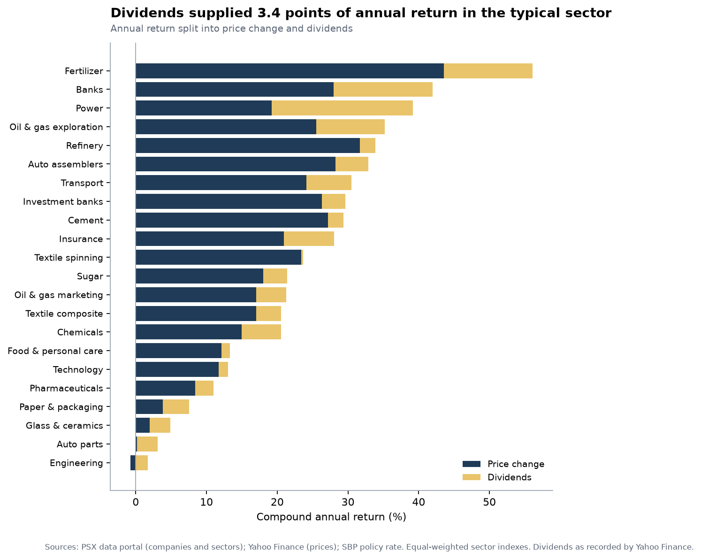

# Which PSX sectors paid best for the risk?

*A memo for anyone deciding which parts of the Pakistan Stock Exchange to study first. Five years, 27 October 2021 to 27 October 2026. This is analysis of the past and is not investment advice.*

## Bottom line

- **By return per unit of risk, the leaders were Fertilizer (1.25), Commercial banks (1.02) and Power generation and distribution (0.87)** (Sharpe ratio; the whole market scored 0.40). Fertilizer returned 56.1% a year with a worst fall of -32%.
- **The top of the ranking is not secure. Fertilizer finishes first in only 54% of the resampled histories, and 3 sectors have at least a 10% chance of finishing first. Read the top group as a shortlist, not a winner.** Its Sharpe ratio of 1.25 has a 95% range of 0.36 to 2.20, and the 95% ranges of the next four sectors all overlap it, so the data cannot separate them from it.
- **The whole market returned 23.9% a year against 16.3% for cash** at the State Bank's policy rate, with a worst fall of -32%. 2 of 22 sectors were very likely better than the market per unit of risk and 5 very likely worse; the other 15 cannot be told apart from it.
- **The ranking is fairly stable when the method is changed.** The top sector stays in the top three in 7 of the 7 alternative ways of doing the analysis in which it is included.
- **No sector's alpha holds up once all 22 are tested together.** Tested one at a time, 5 of the 22 sectors look real (2 positive, 3 negative). Fertilizer has the largest alpha, +28% a year, with a p-value of 0.087 once all 22 sectors are allowed for.
- **The past ranking beat equal weighting out of sample, but not by more than luck could give.** Each month, holding the 3 sectors with the best record over the previous 12 months gave a Sharpe ratio of 1.37 against 0.87 for equal weights, over 48 months and without looking ahead.
- **What moves the sectors.** 60% of the variation in sector returns is one market-wide movement, so the 22 sectors behave like 2.8 independent bets. With the market taken out, the average correlation between two sectors falls from 0.57 to -0.04; the strongest remaining link is Oil and gas exploration with Oil and gas marketing (0.28). Tested together, 0 of the 22 sectors react clearly to interest rates and 1 to the rupee (Automobile assemblers).

## What was measured

Each sector is an equal-weighted portfolio (equal amounts of each company at the start of every month, dividends included) of its companies that trade regularly: 209 companies in 22 ranked sectors, out of 549 in the KSE All Share Index. Companies that rarely trade, or that Yahoo Finance has no prices for, are left out, which is why 209 of 538 operating companies remain; the largest groups left out are listed in the [data sources](data_sources.md). Return is the compound annual growth rate; risk is volatility and the worst fall from a peak; return per unit of risk is the Sharpe ratio, taking cash at the policy rate (which ranged from 7.25% to 22.0% and ended at 12.0%) as the safe alternative. The [methodology](methodology.md) gives the details and the judgement calls.

## The results

|  | Return a year | Volatility | Worst fall | Sharpe |
| --- | ---: | ---: | ---: | ---: |
| Whole market | +23.9% | 22.2% | -32% | 0.40 |
| Cash at the policy rate | +16.3% |  |  |  |

The eight sectors with the best Sharpe ratio:

| Sector | Companies | Return a year | Volatility | Worst fall | Sharpe | 95% range | Chance of top 3 |
| --- | ---: | ---: | ---: | ---: | ---: | ---: | ---: |
| Fertilizer | 4 | +56.1% | 26.3% | -32% | 1.25 | 0.36 to 2.20 | 85% |
| Commercial banks | 16 | +41.9% | 21.9% | -24% | 1.02 | -0.01 to 2.02 | 64% |
| Power generation and distribution | 11 | +39.2% | 24.0% | -31% | 0.87 | -0.16 to 1.89 | 44% |
| Oil and gas exploration | 4 | +35.2% | 25.7% | -31% | 0.71 | -0.12 to 1.51 | 25% |
| Automobile assemblers | 8 | +32.9% | 25.4% | -29% | 0.65 | -0.35 to 1.64 | 20% |
| Refinery | 4 | +33.9% | 42.4% | -42% | 0.54 | -0.32 to 1.41 | 13% |
| Transport | 4 | +30.5% | 31.1% | -34% | 0.52 | -0.45 to 1.47 | 11% |
| Cement | 15 | +29.4% | 30.6% | -48% | 0.50 | -0.40 to 1.40 | 7% |

The four with the weakest:

| Sector | Companies | Return a year | Volatility | Worst fall | Sharpe | 95% range | Chance of top 3 |
| --- | ---: | ---: | ---: | ---: | ---: | ---: | ---: |
| Paper and packaging | 8 | +7.6% | 25.3% | -39% | -0.18 | -1.26 to 0.86 | 0% |
| Glass and ceramics | 6 | +4.9% | 28.2% | -43% | -0.23 | -1.17 to 0.69 | 0% |
| Automobile parts | 6 | +3.1% | 28.6% | -52% | -0.28 | -1.19 to 0.70 | 0% |
| Engineering | 12 | +0.9% | 30.1% | -56% | -0.32 | -1.23 to 0.56 | 0% |

"Chance of top 3" is the share of 2,000 resampled histories in which the sector finished in the top three by Sharpe ratio. All ranked sectors are in [`data/processed/sector_summary.csv`](../data/processed/sector_summary.csv) and on the [dashboard](https://maira-w.github.io/psx-sector-risk-return/).

## What is solid and what is not

**Return and return per unit of risk agree at the top.** Fertilizer had the highest return (56.1% a year); it ranks 1 of 22 by Sharpe ratio (1 is best), with volatility of 26% and a worst fall of 32%.

**Falls were deep.** 22 of 22 sectors fell more than 20% from a peak at some point. The deepest fall was -62% in Textile spinning; the shallowest was -24% in Commercial banks, against -32% for the whole market. 7 sectors were still below their old peak at the end of the window.

**Where the ranking is uncertain.** The top of the ranking is not secure. Fertilizer finishes first in only 54% of the resampled histories, and 3 sectors have at least a 10% chance of finishing first. Read the top group as a shortlist, not a winner. Resampling the days says how much of the ranking could be luck within this one history; it cannot say what a different five years would do.

**It depends on the period.** 4 different sectors led the five twelve-month periods. Leadership rotated almost every year. The rank correlation between the first-half and second-half orderings is 0.16; Fertilizer had the best Sharpe ratio in the first half and Investment banks and securities in the second. The ranking moves a fair amount with the dates used. Across the 4 choices that change the dates (each half, starting three months later, ending three months earlier), the rank correlation with the main result has a median of 0.90 and a minimum of 0.60.

|  | Period | Best sector | Worst sector | Whole market |
| --- | --- | --- | --- | --- |
| Year 1 | Oct 2021 to Oct 2022 | Power generation and distribution (+35%) | Engineering (-38%) | -16% |
| Year 2 | Oct 2022 to Oct 2023 | Power generation and distribution (+80%) | Textile spinning (-22%) | +10% |
| Year 3 | Oct 2023 to Oct 2024 | Fertilizer (+237%) | Textile composite (+17%) | +70% |
| Year 4 | Oct 2024 to Oct 2025 | Investment banks and securities (+319%) | Automobile parts (+18%) | +91% |
| Year 5 | Oct 2025 to Oct 2026 | Refinery (+97%) | Glass and ceramics (-30%) | -2% |

**How much it depends on method.** The ranking is fairly stable when the method is changed. Across 8 alternative ways of doing the analysis (who is included, how the index is built, how returns are measured), the rank correlation with the main result has a median of 0.97 and a minimum of 0.88.

| Choice | Kind | Sectors compared | Rank correlation | Top-3 in common | Main top sector |
| --- | --- | ---: | ---: | ---: | --- |
| KSE-100 companies only | method | 11 | 0.98 | 3 of 3 | still first |
| Must trade on 80% of days | method | 22 | 0.88 | 3 of 3 | still first |
| Must trade on 95% of days | method | 21 | 1.00 | 3 of 3 | still first |
| Without companies with price corrections | method | 17 | 0.97 | 3 of 3 | not in this analysis |
| Rebalanced every day | method | 22 | 0.97 | 3 of 3 | still first |
| Weekly returns | method | 22 | 0.99 | 3 of 3 | still first |
| Without each sector's best company | method | 22 | 0.96 | 3 of 3 | still first |
| Typical company (median) | method | 22 | 0.93 | 2 of 3 | still first |
| First half of the window | period | 22 | 0.83 | 2 of 3 | still first |
| Second half of the window | period | 22 | 0.60 | 1 of 3 | falls out of the top 3 |
| Start 3 months later | period | 22 | 0.98 | 3 of 3 | still first |
| End 3 months earlier | period | 22 | 0.97 | 3 of 3 | still first |

**Dividends were a meaningful part of the return.** In the typical sector dividends supplied about 22% of the annual return (3.4 percentage points), and 20.0 points in Power generation and distribution. For the whole market that is 21% of its return.

## Is it skill or luck?

A sector can rank high because it moves with a rising market, or because it carries little of the market's risk, without having done anything special. To separate these, each sector's weekly return above cash is set against the weekly return of the rest of the market (every company outside that sector, equal-weighted). **Beta** is how strongly the sector follows the rest of the market; **alpha** is the return a year that is left over. The median beta was 0.97, from 0.59 for Fertilizer to 1.37 for Textile spinning, and the rest of the market explains a median 53% of a sector's weekly ups and downs. Sectors with a lower beta tended to have the higher Sharpe ratio (rank correlation -0.52), and all of the top three are among the five lowest-beta sectors. That describes these five years, in which the whole market's Sharpe ratio was 0.40.

**No sector's alpha holds up once all 22 are tested together.** Tested one at a time, 5 of the 22 sectors look real (2 positive, 3 negative). The correction matters because the best of 22 sectors looks good by chance: even if none had any alpha, the largest t-statistic among 22 would exceed 3.11 one time in twenty, so a sector has to beat that bar, not the usual 1.96. Fertilizer has the largest alpha, +28% a year (t = 2.7; p = 0.006 on its own, 0.087 after the correction). Engineering has the lowest, -21% a year (p = 0.0003 on its own, 0.060 after the correction). On the looser false-discovery-rate rule, which accepts that a small share of findings may be false, Engineering (-21% a year) clears the bar.

| Sector | Beta | Alpha a year | t | p alone | p corrected | Deflated Sharpe |
| --- | ---: | ---: | ---: | ---: | ---: | ---: |
| Engineering | 1.15 | -21% | -3.6 | <0.001 | 0.060 | 0.01 |
| Fertilizer | 0.59 | +28% | 2.7 | 0.006 | 0.087 | 0.84 |
| Glass and ceramics | 1.04 | -17% | -2.4 | 0.016 | 0.544 | 0.01 |
| Commercial banks | 0.69 | +17% | 2.4 | 0.018 | 0.359 | 0.68 |
| Automobile parts | 1.08 | -17% | -2.3 | 0.023 | 0.505 | 0.01 |
| Paper and packaging | 0.97 | -14% | -1.8 | 0.078 | 0.793 | 0.01 |
| Power generation and distribution | 0.82 | +15% | 1.7 | 0.096 | 0.809 | 0.55 |
| Oil and gas exploration | 0.70 | +12% | 1.5 | 0.125 | 0.956 | 0.41 |
| Food and personal care | 1.10 | -9% | -1.4 | 0.152 | 0.969 | 0.04 |
| Pharmaceuticals | 1.00 | -10% | -1.4 | 0.176 | 0.983 | 0.03 |
| Technology and communication | 1.09 | -8% | -1.2 | 0.216 | 0.993 | 0.05 |
| Automobile assemblers | 0.89 | +9% | 1.0 | 0.341 | 0.998 | 0.36 |
| Transport | 0.91 | +11% | 0.9 | 0.364 | 1.000 | 0.26 |
| Refinery | 1.27 | +14% | 0.9 | 0.384 | 1.000 | 0.27 |
| Cement | 0.94 | +6% | 0.7 | 0.482 | 1.000 | 0.24 |
| Insurance | 0.97 | +5% | 0.7 | 0.506 | 1.000 | 0.23 |
| Investment banks and securities | 1.17 | +8% | 0.5 | 0.590 | 1.000 | 0.22 |
| Textile spinning | 1.37 | +6% | 0.3 | 0.755 | 1.000 | 0.15 |
| Sugar | 0.67 | +2% | 0.2 | 0.809 | 1.000 | 0.12 |
| Chemicals | 0.88 | -1% | -0.2 | 0.851 | 1.000 | 0.11 |
| Oil and gas marketing | 1.14 | -1% | -0.1 | 0.907 | 1.000 | 0.12 |
| Textile composite | 0.93 | -1% | -0.1 | 0.908 | 1.000 | 0.11 |

The Sharpe ratio gets the same treatment. With no skill at all, the best Sharpe ratio among 22 sectors would be expected to reach about 0.81, given how widely their Sharpe ratios are spread; the best actual one is 1.25. The *deflated Sharpe ratio* turns that into a probability that the true Sharpe ratio is above the luck bar: 0.84 for Fertilizer, where 0.95 would be convincing, and none reaches it.

## What moves the sectors?

**One market, and a few small groups.** 60% of the variation in sector returns is one market-wide movement, so the 22 sectors behave like 2.8 independent bets. With the market taken out, the average correlation between two sectors falls from 0.57 to -0.04; the strongest remaining link is Oil and gas exploration with Oil and gas marketing (0.28). The first principal component carries 60% of the variation in sector returns, the second 4% and the third 3%. After the market is taken out, the sectors that still move together fall into 4 groups (found by clustering; they describe these five years and are not a classification):

| Group | Sectors |
| --- | --- |
| A | Sugar, Investment banks and securities and Textile spinning |
| B | Cement, Engineering, Textile composite, Chemicals, Glass and ceramics and Paper and packaging |
| C | Insurance, Power generation and distribution, Commercial banks and Fertilizer |
| D | Transport, Pharmaceuticals, Automobile assemblers, Automobile parts, Technology and communication, Food and personal care, Refinery, Oil and gas exploration and Oil and gas marketing |

The five strongest links beyond the market:

| First sector | Second sector | Correlation |
| --- | --- | ---: |
| Oil and gas exploration | Oil and gas marketing | 0.28 |
| Automobile assemblers | Automobile parts | 0.14 |
| Oil and gas marketing | Refinery | 0.14 |
| Commercial banks | Fertilizer | 0.14 |
| Oil and gas exploration | Refinery | 0.12 |

**Interest rates and the rupee.** For each of the 59 full months, a sector's return above cash is explained by the rest of the market's return, the change in the State Bank's policy rate (it changed in 19 of those months) and the change in rupees per dollar. Tested together, 0 of the 22 sectors react clearly to interest rates and 1 to the rupee (Automobile assemblers). Tested one at a time, 4 of the 22 sectors show a rate effect (Automobile assemblers, Sugar and Textile composite did better in months when the rate rose; Pharmaceuticals did worse in months when the rate rose). Tested one at a time, 1 of the 22 sectors shows a rupee effect (Automobile assemblers did worse in months when the rupee weakened).

| Sector | Rate effect (% per point) | p | p corrected | Rupee effect (% per 1% weaker) | p | p corrected |
| --- | ---: | ---: | ---: | ---: | ---: | ---: |
| Automobile assemblers | +1.40 | 0.030 | 0.217 | -0.51 | <0.001 | <0.001 |
| Sugar | +1.49 | 0.013 | 0.141 | +0.05 | 0.572 | 0.859 |
| Pharmaceuticals | -2.14 | 0.013 | 0.141 | -0.11 | 0.419 | 0.859 |
| Textile composite | +1.45 | 0.045 | 0.227 | +0.03 | 0.797 | 0.894 |

Effects are in percent of return in a month, for one percentage point more on the policy rate and for a rupee that is 1% weaker. They are estimated from 59 months, so the ranges are wide (see the figure), and the market, rates and the rupee together explain a median 60% of a sector's monthly return above cash.

## Could you have used the ranking?

The ranking looks back over five years. To see whether it could have been used, a rule is run month by month: on the last day of each month it chooses weights using only the previous 12 months, and the portfolio is held through the next month. That gives 48 months of results, from Nov 2022, that the rule could not have known in advance. Five rules are compared with the whole market and with holding all 22 sectors equally: the 3 sectors with the best past Sharpe ratio, the 3 with the worst (a control), minimum variance, and inverse volatility.

| Rule | Return a year | Volatility | Worst fall | Sharpe | Sharpe minus equal weight | 95% range | p | p corrected | Traded each month |
| --- | ---: | ---: | ---: | ---: | ---: | ---: | ---: | ---: | ---: |
| Equal weight, all sectors | +39.2% | 22.7% | -29% | 0.87 |  |  |  |  | 2% |
| Best sectors of the past year | +58.1% | 23.9% | -28% | 1.37 | +0.51 | -0.05 to +1.09 | 0.070 | 0.350 | 21% |
| Worst sectors of the past year | +29.1% | 24.5% | -27% | 0.51 | -0.35 | -0.84 to +0.05 | 0.103 | 0.515 | 27% |
| Minimum variance | +49.6% | 19.4% | -25% | 1.35 | +0.49 | +0.10 to +0.92 | 0.018 | 0.090 | 9% |
| Inverse volatility | +38.9% | 22.1% | -29% | 0.87 | +0.01 | -0.04 to +0.06 | 0.685 | 1.000 | 3% |
| Whole market | +37.5% | 22.4% | -30% | 0.82 | -0.05 | -0.15 to +0.05 | 0.365 | 1.000 |  |

The range and the p-value come from resampling the days 2000 times; "p corrected" multiplies by the five comparisons made.

**The past ranking beat equal weighting out of sample, but not by more than luck could give.** Holding the 3 sectors with the best past Sharpe ratio returned 58% a year with a Sharpe ratio of 1.37, against 39% and 0.87 for equal weights: a difference of +0.51 in the Sharpe ratio (p = 0.070; 0.350 after allowing for five comparisons). The worst 3 returned a Sharpe ratio of 0.51. The rank correlation between the past Sharpe ratios and the next month's returns averaged +0.07 (t = 1.8) and was positive in 60% of months. On average the past ranking pointed the right way, but only weakly.

The same rule with other look-backs and numbers of sectors was ahead of equal weights in 5 of 6 choices and clearly ahead (p below 0.05) in 2:

| Look-back | Sectors held | Months tested | Sharpe of the rule | Sharpe of equal weights | Difference | p |
| --- | ---: | ---: | ---: | ---: | ---: | ---: |
| 6 months | 3 | 54 | 1.20 | 0.62 | +0.58 | 0.034 |
| 6 months | 5 | 54 | 1.02 | 0.62 | +0.40 | 0.042 |
| 12 months | 3 | 48 | 1.37 | 0.87 | +0.51 | 0.070 |
| 12 months | 5 | 48 | 1.23 | 0.87 | +0.36 | 0.082 |
| 24 months | 3 | 36 | 1.44 | 1.15 | +0.29 | 0.380 |
| 24 months | 5 | 36 | 1.13 | 1.15 | -0.02 | 0.942 |

Weights chosen to make the portfolio as steady as possible gave a volatility of 19% against 23% and a Sharpe ratio of 1.35 against 0.87. The gain in Sharpe ratio is significant on its own (p = 0.018) but not after allowing for the five comparisons made (p = 0.090). A rule that favours low-risk sectors does best in a window in which low-risk sectors did well. The lower-beta sectors did lead in this window (rank correlation -0.52 between beta and the Sharpe ratio), so part of this result may belong to these five years.

The comparisons between rules are fairer than their levels: every rule uses today's surviving companies, which lifts all of them alike, and five years is one history. The dashboard has a portfolio builder (monthly rebalanced; its presets are worked out in hindsight from the whole five years) to see what diversification does. It is a way to explore, not a test.

## What this suggests

These are ways to use the numbers, not recommendations to buy or sell anything.

1. **Use the ranking to choose where to look first.** Fertilizer, Commercial banks, Power generation and distribution, Oil and gas exploration and Automobile assemblers are the five best by Sharpe ratio and a reasonable shortlist for closer study (company accounts, valuations and what drove each sector's run). Use it to build a shortlist, not to pick a winner.
2. **Weigh the worst fall as well as the return.** Anyone holding a sector would have lived through the fall in the table above, and 7 sectors had not regained their old peak by the end of the window.
3. **Look at how much sectors move together.** The average correlation between sector returns was 0.57. The lowest was 0.34, between Insurance and Sugar. Sugar moved least with the market (0.54).
4. **Do not lean on last period's leader.** Between the first and second half the rank correlation was 0.16, so a sector's record over one stretch has been only a weak guide to the next.
5. **Think in bets, not sector names.** The 22 sectors behave like 2.8 independent bets, so two sectors in the same group diversify each other less than their names suggest.
6. **Do not read a good record as skill, and be careful with a rule built on last year's winners.** No sector's alpha holds up once all 22 are tested together. The past ranking beat equal weighting out of sample, but not by more than luck could give.

## What would change the answer

- **A different window.** The window spans the policy rate rising from 7.25% to 22.0% and later coming down to 12.0%; another five years would rank the sectors differently.
- **More history.** The alpha tests rest on 262 weeks and the out-of-sample test on 48 months. A longer record, or other markets, is what would separate skill from luck.
- **Delisted companies.** Including companies that left the exchange would probably lower returns.
- **Value weights.** An index weighted by company size would be driven by the largest companies in each sector.
- **Better data.** The exchange's own prices, with complete dividend records, would replace Yahoo Finance.
- **Dollar returns.** All returns here are in rupees. For a foreign investor the picture differs: rupees per dollar went from 174.5 to 276.8, so in dollars the whole market returned 13.0% a year against 23.9% in rupees.

## Not investment advice

This memo describes what happened. Past performance does not predict future returns, and nothing here is a recommendation to buy or sell any security.
