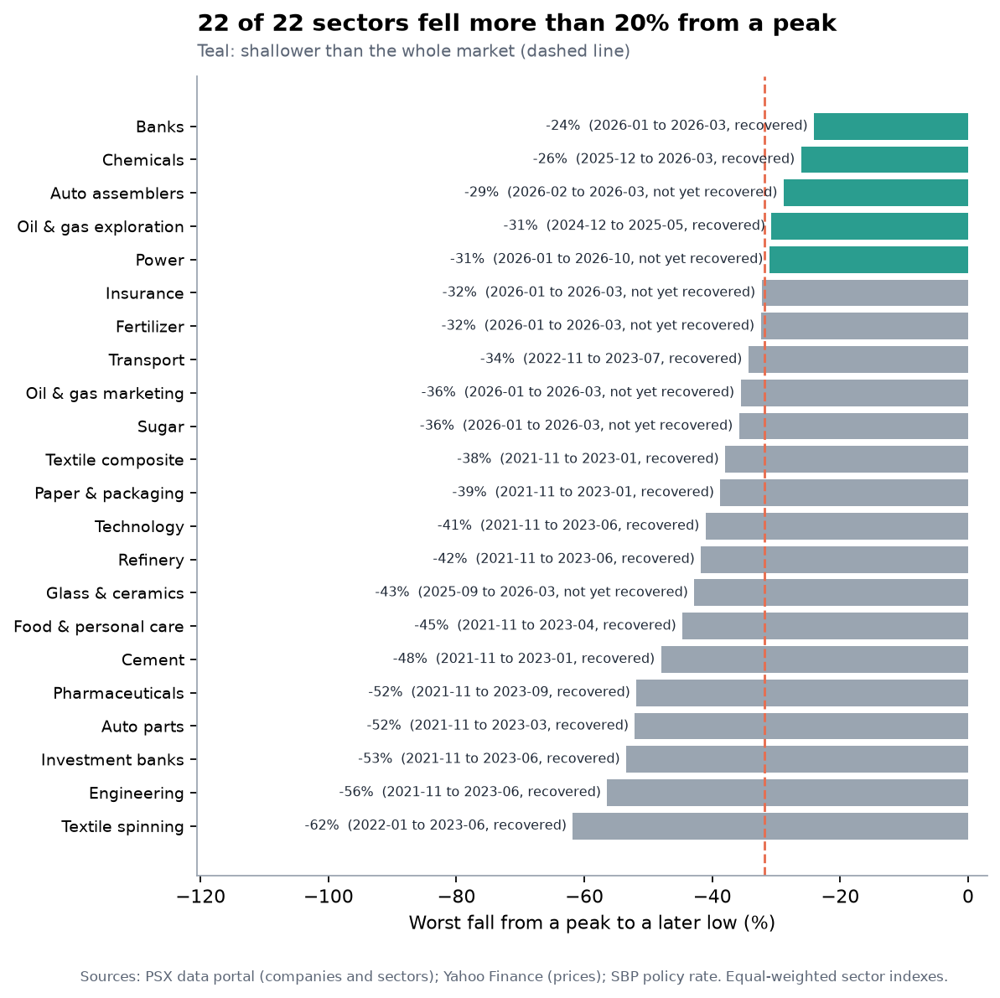
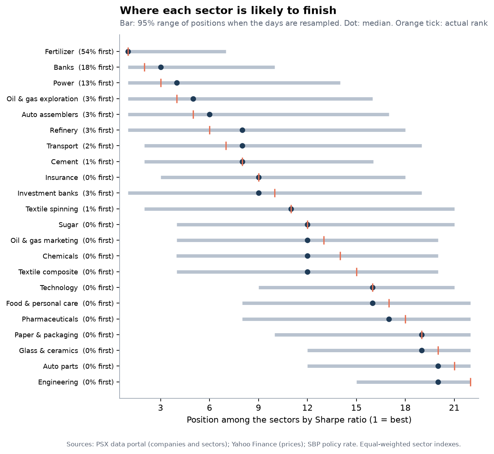
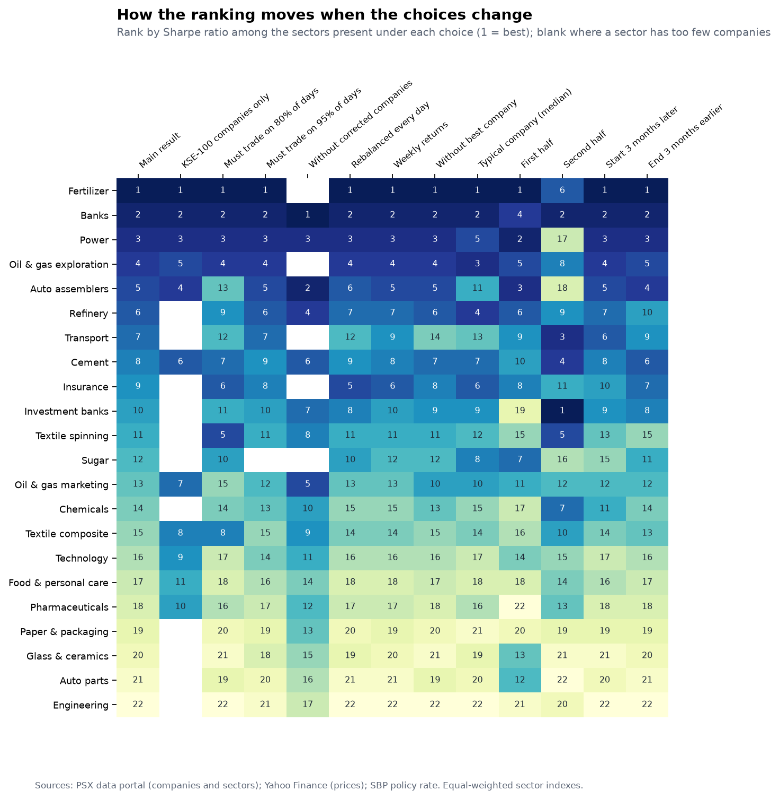

# Which PSX sectors paid best for the risk?

*A memo for anyone deciding which parts of the Pakistan Stock Exchange to study first. Five years, 27 October 2021 to 27 October 2026. This is analysis of the past and is not investment advice.*

## Bottom line

- **By return per unit of risk, the leaders were Fertilizer (1.25), Commercial banks (1.02) and Power generation and distribution (0.87)** (Sharpe ratio; the whole market scored 0.40). Fertilizer returned 56.1% a year with a worst fall of -32%.
- **The top of the ranking is not secure. Fertilizer finishes first in only 54% of the resampled histories, and 3 sectors have at least a 10% chance of finishing first. Read the top group as a shortlist, not a winner.** Its Sharpe ratio of 1.25 has a 95% range of 0.36 to 2.20, and the 95% ranges of the next four sectors all overlap it, so the data cannot separate them from it.
- **The whole market returned 23.9% a year against 16.3% for cash** at the State Bank's policy rate, with a worst fall of -32%. 2 of 22 sectors were very likely better than the market per unit of risk and 5 very likely worse; the other 15 cannot be told apart from it.
- **The ranking is fairly stable when the method is changed.** The top sector stays in the top three in 7 of the 7 alternative ways of doing the analysis in which it is included.

## What was measured

Each sector is an equal-weighted portfolio (equal amounts of each company at the start of every month, dividends included) of its companies that trade regularly: 209 companies in 22 ranked sectors, out of 549 in the KSE All Share Index. Companies that rarely trade, or that Yahoo Finance has no prices for, are left out, which is why 209 of 538 operating companies remain; the largest groups left out are listed in the [data sources](data_sources.md). Return is the compound annual growth rate; risk is volatility and the worst fall from a peak; return per unit of risk is the Sharpe ratio, taking cash at the policy rate (which ranged from 7.25% to 22.0% and ended at 12.0%) as the safe alternative. The [methodology](methodology.md) gives the details and the judgement calls.

## The results

|  | Return a year | Volatility | Worst fall | Sharpe |
| --- | ---: | ---: | ---: | ---: |
| Whole market | +23.9% | 22.2% | -32% | 0.40 |
| Cash at the policy rate | +16.3% |  |  |  |

The eight sectors with the best Sharpe ratio:

| Sector | Companies | Return a year | Volatility | Worst fall | Sharpe | 95% range | Chance of top 3 |
| --- | ---: | ---: | ---: | ---: | ---: | ---: | ---: |
| Fertilizer | 4 | +56.1% | 26.3% | -32% | 1.25 | 0.36 to 2.20 | 85% |
| Commercial banks | 16 | +41.9% | 21.9% | -24% | 1.02 | -0.01 to 2.02 | 64% |
| Power generation and distribution | 11 | +39.2% | 24.0% | -31% | 0.87 | -0.16 to 1.89 | 44% |
| Oil and gas exploration | 4 | +35.2% | 25.7% | -31% | 0.71 | -0.12 to 1.51 | 25% |
| Automobile assemblers | 8 | +32.9% | 25.4% | -29% | 0.65 | -0.35 to 1.64 | 20% |
| Refinery | 4 | +33.9% | 42.4% | -42% | 0.54 | -0.32 to 1.41 | 13% |
| Transport | 4 | +30.5% | 31.1% | -34% | 0.52 | -0.45 to 1.47 | 11% |
| Cement | 15 | +29.4% | 30.6% | -48% | 0.50 | -0.40 to 1.40 | 7% |

The four with the weakest:

| Sector | Companies | Return a year | Volatility | Worst fall | Sharpe | 95% range | Chance of top 3 |
| --- | ---: | ---: | ---: | ---: | ---: | ---: | ---: |
| Paper and packaging | 8 | +7.6% | 25.3% | -39% | -0.18 | -1.26 to 0.86 | 0% |
| Glass and ceramics | 6 | +4.9% | 28.2% | -43% | -0.23 | -1.17 to 0.69 | 0% |
| Automobile parts | 6 | +3.1% | 28.6% | -52% | -0.28 | -1.19 to 0.70 | 0% |
| Engineering | 12 | +0.9% | 30.1% | -56% | -0.32 | -1.23 to 0.56 | 0% |

"Chance of top 3" is the share of 2,000 resampled histories in which the sector finished in the top three by Sharpe ratio. All ranked sectors are in [`data/processed/sector_summary.csv`](../data/processed/sector_summary.csv) and on the [dashboard](https://maira-w.github.io/psx-sector-risk-return/).

## What is solid and what is not

**Return and return per unit of risk agree at the top.** Fertilizer had the highest return (56.1% a year); it ranks 1 of 22 by Sharpe ratio (1 is best), with volatility of 26% and a worst fall of 32%.

**Falls were deep.** 22 of 22 sectors fell more than 20% from a peak at some point. The deepest fall was -62% in Textile spinning; the shallowest was -24% in Commercial banks, against -32% for the whole market. 7 sectors were still below their old peak at the end of the window.

**Where the ranking is uncertain.** The top of the ranking is not secure. Fertilizer finishes first in only 54% of the resampled histories, and 3 sectors have at least a 10% chance of finishing first. Read the top group as a shortlist, not a winner. Resampling the days says how much of the ranking could be luck within this one history; it cannot say what a different five years would do.

**It depends on the period.** 4 different sectors led the five twelve-month periods. Leadership rotated almost every year. The rank correlation between the first-half and second-half orderings is 0.16; Fertilizer had the best Sharpe ratio in the first half and Investment banks and securities in the second. The ranking moves a fair amount with the dates used. Across the 4 choices that change the dates (each half, starting three months later, ending three months earlier), the rank correlation with the main result has a median of 0.90 and a minimum of 0.60.

|  | Period | Best sector | Worst sector | Whole market |
| --- | --- | --- | --- | --- |
| Year 1 | Oct 2021 to Oct 2022 | Power generation and distribution (+35%) | Engineering (-38%) | -16% |
| Year 2 | Oct 2022 to Oct 2023 | Power generation and distribution (+80%) | Textile spinning (-22%) | +10% |
| Year 3 | Oct 2023 to Oct 2024 | Fertilizer (+237%) | Textile composite (+17%) | +70% |
| Year 4 | Oct 2024 to Oct 2025 | Investment banks and securities (+319%) | Automobile parts (+18%) | +91% |
| Year 5 | Oct 2025 to Oct 2026 | Refinery (+97%) | Glass and ceramics (-30%) | -2% |

**How much it depends on method.** The ranking is fairly stable when the method is changed. Across 8 alternative ways of doing the analysis (who is included, how the index is built, how returns are measured), the rank correlation with the main result has a median of 0.97 and a minimum of 0.88.

| Choice | Kind | Sectors compared | Rank correlation | Top-3 in common | Main top sector |
| --- | --- | ---: | ---: | ---: | --- |
| KSE-100 companies only | method | 11 | 0.98 | 3 of 3 | still first |
| Must trade on 80% of days | method | 22 | 0.88 | 3 of 3 | still first |
| Must trade on 95% of days | method | 21 | 1.00 | 3 of 3 | still first |
| Without companies with price corrections | method | 17 | 0.97 | 3 of 3 | not in this analysis |
| Rebalanced every day | method | 22 | 0.97 | 3 of 3 | still first |
| Weekly returns | method | 22 | 0.99 | 3 of 3 | still first |
| Without each sector's best company | method | 22 | 0.96 | 3 of 3 | still first |
| Typical company (median) | method | 22 | 0.93 | 2 of 3 | still first |
| First half of the window | period | 22 | 0.83 | 2 of 3 | still first |
| Second half of the window | period | 22 | 0.60 | 1 of 3 | falls out of the top 3 |
| Start 3 months later | period | 22 | 0.98 | 3 of 3 | still first |
| End 3 months earlier | period | 22 | 0.97 | 3 of 3 | still first |

**Dividends were a meaningful part of the return.** In the typical sector dividends supplied about 22% of the annual return (3.4 percentage points), and 20.0 points in Power generation and distribution. For the whole market that is 21% of its return.

## What this suggests

These are ways to use the numbers, not recommendations to buy or sell anything.

1. **Use the ranking to choose where to look first.** Fertilizer, Commercial banks, Power generation and distribution, Oil and gas exploration and Automobile assemblers are the five best by Sharpe ratio and a reasonable shortlist for closer study (company accounts, valuations and what drove each sector's run). Use it to build a shortlist, not to pick a winner.
2. **Weigh the worst fall as well as the return.** Anyone holding a sector would have lived through the fall in the table above, and 7 sectors had not regained their old peak by the end of the window.
3. **Look at how much sectors move together.** The average correlation between sector returns was 0.57. The lowest was 0.34, between Insurance and Sugar. Sugar moved least with the market (0.54).
4. **Do not lean on last period's leader.** Between the first and second half the rank correlation was 0.16, so a sector's record over one stretch has been only a weak guide to the next.

## What would change the answer

- **A different window.** The window spans the policy rate rising from 7.25% to 22.0% and later coming down to 12.0%; another five years would rank the sectors differently.
- **Delisted companies.** Including companies that left the exchange would probably lower returns.
- **Value weights.** An index weighted by company size would be driven by the largest companies in each sector.
- **Better data.** The exchange's own prices, with complete dividend records, would replace Yahoo Finance.
- **Dollar returns.** All returns here are in rupees. For a foreign investor the picture differs: rupees per dollar went from 174.5 to 276.8, so in dollars the whole market returned 13.0% a year against 23.9% in rupees.

## Not investment advice

This memo describes what happened. Past performance does not predict future returns, and nothing here is a recommendation to buy or sell any security.
